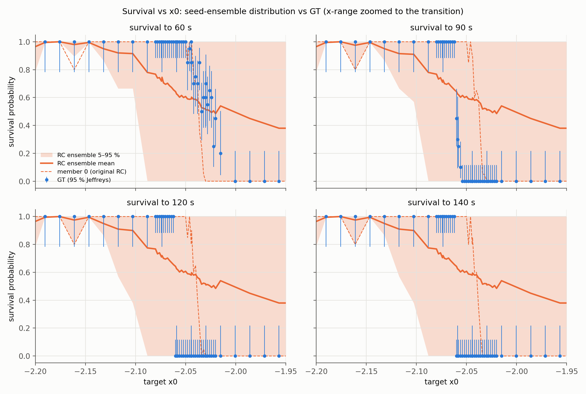
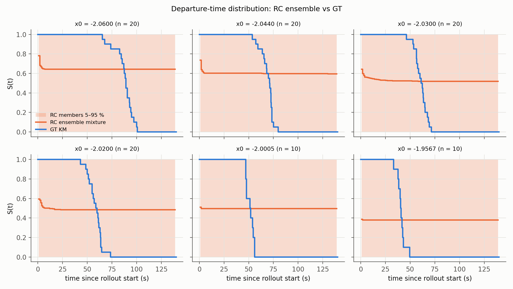
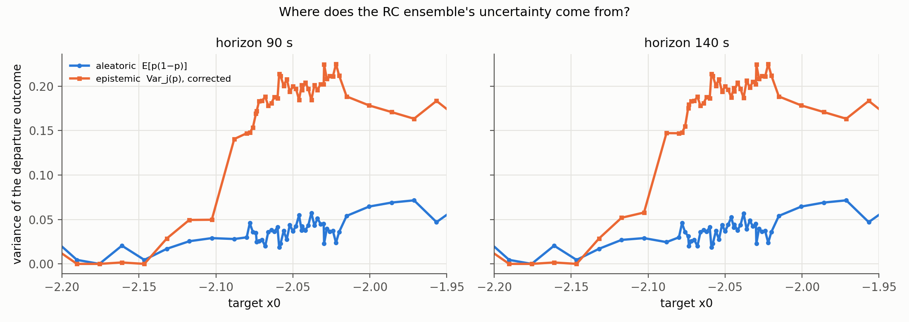
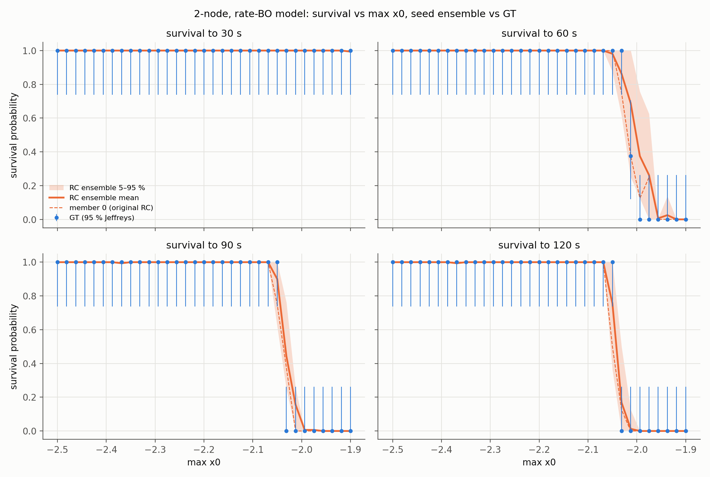
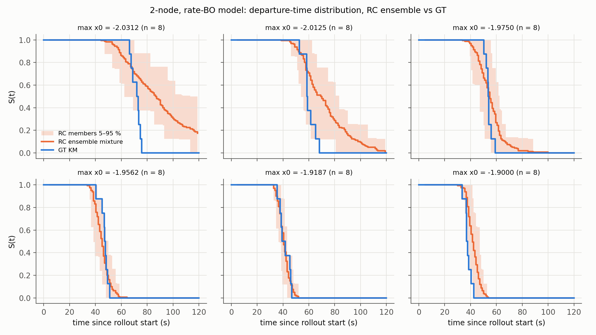
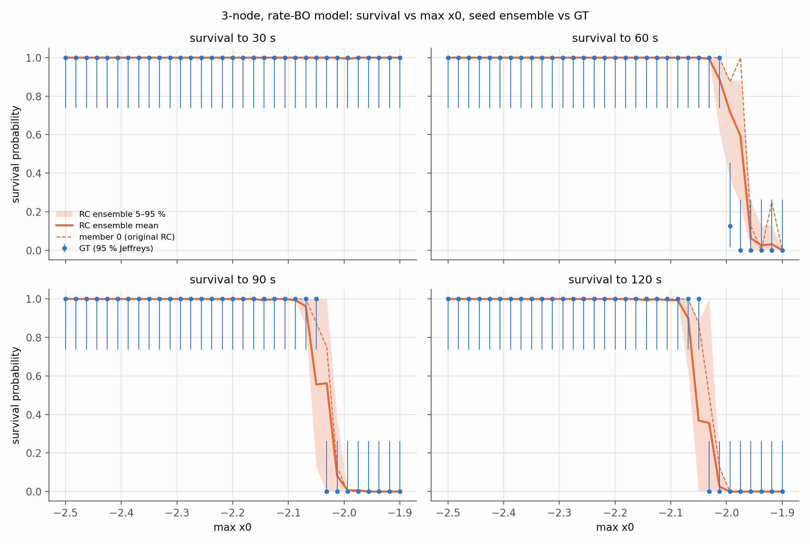
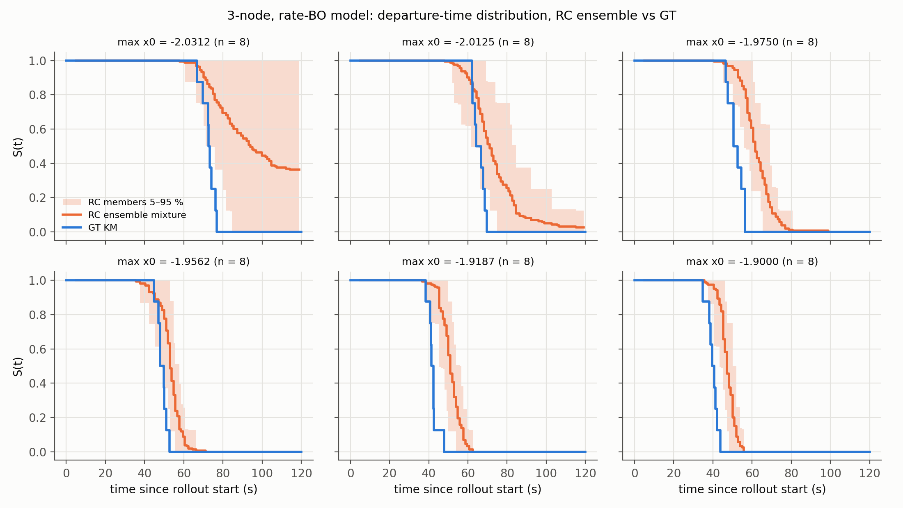
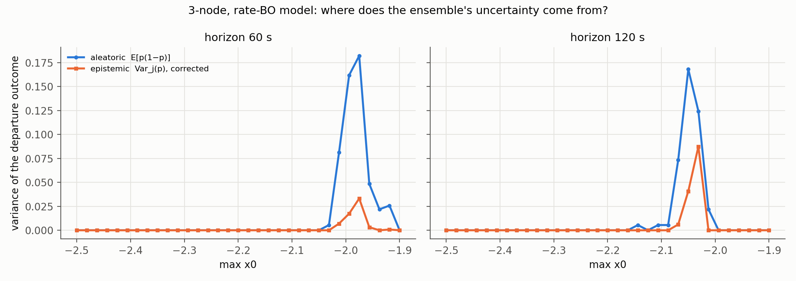

# Survival rate를 분포로 평가하기 — 중간 보고서

> 작성 2026-10-13 · 대상: 공동 연구자, 그리고 나중의 나
> 자세한 근거: [01 기존 로직](01_current_pipeline.md) · [02 지표 정의](02_metrics.md) · [03 진행 기록](03_progress_log.md) · [아이디어와 문헌](../survival_distribution_plan.md)
> 코드: `survival_dist/` (실행 방법은 `survival_dist/README.md`)
>
> **⚠ 이후 갱신 (같은 날, 이 보고서 이후의 분석):** 아래 "앙상블이 원래 RC보다 낫다"는 비교는 rollout 수를 맞추지 않은 비교였다.
> - [04_fair_comparison.md](04_fair_comparison.md) §6: rollout 수를 맞춘 대조군(arm B)과 비교하면 앙상블의 우위는 통계적으로 지지되지 않는다.
> - [05_next_experiments.md](05_next_experiments.md): seed별 임계값 분포(§1b–1c), 잔차 시간 상관 가설 검증(§3.1, 기각)을 다룬다.
> - 해당 문장에는 ⚠ 표시를 달았다.

---

## 요약

- **질문:** SCDT-RC가 내는 survival rate를 *점 하나*가 아니라 *분포*로 보면, 모델이 GT의 정상 이탈(발작 시작)을 얼마나 믿을 만하게 예측하는가?
- **방법:**
  - 고정된 하이퍼파라미터에서 reservoir seed만 바꾼 **20개 멤버 앙상블**을 만든다.
  - 생존분석과 확률 예보 분야의 표준 지표로 채점한다: 시행 단위 Brier, reliability, Kaplan–Meier, integrated Brier score, D-calibration, x50 분포, 불확실성 분해.
  - single node, 2-node, 3-node에 같은 방식으로 적용했다.
- **핵심 결과:**
  1. **single node RC는 분포 평가를 통과하지 못한다.**
     - seed만 바꿔도 행동이 극단적으로 달라진다 (Brier 0.08–0.63).
     - RC 이탈의 67%는 신호가 발산해 clip 경계에 붙은 수치 현상이다.
     - 이탈 시점은 전환 후 1 s 이내로, GT의 약 80 s와 전혀 맞지 않는다.
     - 기존 survival MAE(0.077)는 이 문제를 드러내지 못했다.
  2. **2-node와 3-node RC는 통과한다.**
     - seed에 강건하고, clip 포화가 없고, 이탈 시점까지 예측한다.
     - IBS 0.008 / 0.015로 기준선 0.11보다 훨씬 낫다.
     - 특히 2-node는 앙상블 예측의 보정도 맞는다 (D-calibration p = 0.59).
  3. **세 시스템 모두 GT의 "horizon 시점 생존"은 x0에 대한 계단 함수다.** 이 노이즈 수준에서 확률성은 **이탈 시점의 퍼짐**에 있다. 그래서 시간 축 지표가 필수다.
  4. **재현성 문제:** 원본 3-node 파이프라인을 다시 실행하면 마지막 확인 단계가 후보를 하나도 고르지 못한다. 그래서 저장소 그림을 만든 최종 모델은 재현되지 않았다. 2-node 변형도 같다.

---

## 1. 배경과 질문

### 1.1 기존 실험
- **GT:** Epileptor (Proix et al. 2017 식). 관측 신호는 x2 − x1이다.
  - base x0(정상)에서 warmup한 뒤 target x0로 바꾸고 미래 구간을 생성한다.
- **RC (SCDT):** 동적 입력(신호) + **static 입력(관측 통계 좌표)** 을 받는 sparse reservoir.
  - 같은 GT warmup으로 warm-up한 뒤, static을 target 좌표로 바꾸고 autonomous rollout을 한다.
  - GT 시행과 RC 시행은 같은 warmup을 공유하는 짝이다.
- **survival rate:** x0(3-node는 max x0)마다 "horizon 안에 정상 이탈이 없던 시행의 비율".

| | single node | 3-node | 2-node (이번에 새로 만듦) |
|---|---|---|---|
| 이탈 정의 | proxy ≤ −2.0인 첫 국소 최소 | 어느 노드든 proxy ≤ −0.5 (처음 5 s 제외) | 3-node와 같음 |
| horizon | 140 s | 120 s | 120 s |
| static 통계 | 2개 (자동 선택: permutation entropy, std) | 9개 (노드별 mean / std / AC1) | 6개 |
| reservoir | 280 노드 | 1500 노드, block innovation | 1500 노드 |
| BO에서 reservoir seed | 시행마다 다름 | 고정 | 고정 |
| 학습 데이터 | 정상 궤적만 | 정상 + 이탈 궤적 | 정상 + 이탈 궤적 |

### 1.2 왜 분포로 보나
기존 평가는 RC **한 개**가 낸 x0별 비율을 GT 비율과 비교한다 (survival MAE). 여기에는 세 가지가 빠져 있다.
1. **모델 불확실성:** 같은 하이퍼파라미터의 다른 reservoir도 같은 답을 내는가?
2. **GT 표본 불확실성:** GT 비율도 seed 10개 안팎에서 나온 추정치다.
3. **시간:** 이탈 *여부*만 보고 *언제* 이탈하는지는 버린다.

---

## 2. 방법

### 2.1 무엇을 "분포"로 보나

| 층위 | 무엇 | 어떻게 |
|---|---|---|
| 모델 불확실성 | seed만 다른 20개 멤버의 이탈 확률 p_j(x0) | 멤버 간 분포, 5–95% 밴드, 멤버별 x50 |
| 사건 시점 | 이탈 시점 T의 분포 S(t) = P(T > t) | Kaplan–Meier, 앙상블 혼합 곡선 |
| GT 표본 불확실성 | 유한 seed로 얻은 GT 비율 | Jeffreys 구간 Beta(k+½, n−k+½), bootstrap |

### 2.2 지표 (정의와 근거는 [02](02_metrics.md))

| 지표 | 묻는 것 | 읽는 법 |
|---|---|---|
| **시행 단위 Brier / BSS** | horizon 안 이탈 확률이 맞나 | 0 = 완벽. BSS = 1 − BS / BS(climatology) |
| Murphy 분해, reliability diagram | 확률이 보정되었나 | REL은 낮을수록, RES는 높을수록 좋다 |
| **IBS** (integrated Brier score) | 시점까지 포함해 생존곡선이 맞나 | 0 = 완벽. 비교 기준: x0를 무시한 KM 하나 |
| **D-calibration** | 예측 생존곡선 기준으로 실제 이탈 시점이 균등하게 퍼지나 | p가 작으면 시점 분포가 체계적으로 틀렸다 |
| x50(h) | "h초 안에 절반이 이탈하는 x0" | 임계점 위치. 멤버별 분포와 GT bootstrap을 비교 |
| 불확실성 분해 | p̄(1−p̄) = E[p(1−p)] + Var(p) | aleatoric(시스템 확률성)과 epistemic(멤버 간 불일치) |
| 이탈 종류 | RC 이탈이 clip 포화인가, 동역학적인가 | 수치 발산을 물리적 이탈과 구분한다 |

- **oracle:** 독립 seed로 다시 돌린 GT의 빈도. 유한 GT로 도달할 수 있는 최선이다.
- **climatology:** x0를 무시하고 전체 평균 이탈률을 말하는 예측. 이것을 넘어야 실력이 있다고 본다.

### 2.3 근거 문헌 (자세한 목록은 plan 문서)
- 파라미터 채널 RC로 전이와 transient lifetime 분포를 예측: Kong et al. 2021 (*PRR*)
- 실제 iEEG의 critical slowing down: Maturana et al. 2020 (*Nat. Commun.*)
- 비율 구간: Brown, Cai & DasGupta 2001
- 앙상블 불확실성: Lakshminarayanan et al. 2017, McDermott & Wikle 2017 (ESN 앙상블)
- 평가: Gneiting et al. 2007, Murphy 1973, Bröcker & Smith 2007, Graf et al. 1999 (IBS), Haider et al. 2020 (D-calibration)
- seizure forecasting의 BSS 관행: Proix et al. 2021

### 2.4 구현과 검증
- 원본 `final_code/`는 **수정하지 않았다.** 다중 노드는 코드 사본에서 실행했다.
- 지표 모듈 selftest 18/18 통과 (KM, Greenwood, BS(t), IBS는 scikit-survival과 수치가 일치).
- **모든 앙상블에서 멤버 0 = 원래 모델**이고, 원래 결과를 시행 단위로 **정확히** 재현하는 것을 통과 조건으로 두었다. 다섯 앙상블 모두 통과했다.
- EESN(Julia)에서 가져온 것: `kaplan_meier`, CRPS, `train_ensemble_checkpointed` 구조, health 판정 아이디어. 모두 static 입력을 받도록 고쳐서 Python으로 옮겼다.
- 쓰지 않은 것: refill(나쁜 멤버 교체)은 사용자 결정으로 뺐다. resync는 정상 이탈을 지워 survival을 부풀리므로 뺐다.

---

## 3. 결과

### 3.1 GT 자체: 생존은 계단이고, 확률성은 시점에 있다
- single node 정밀 탐색 (seed 20/x0, 간격 0.00005): **x0 ≤ −2.06135는 140 s 동안 전부 생존, x0 ≥ −2.06130은 전부 이탈**한다. 이탈 시점은 80–116 s다.
  - 위치는 축약식 Hopf 점(약 −2.062)과 같다. 이 노이즈 수준에서는 노이즈로 인한 확률적 생존 구간이 사실상 없다.
- 2-node와 3-node도 120 s 시점에서 결과가 섞인 max x0 단계가 0개다.
- 반면 이탈 **시점**은 x0마다 수 초에서 10 s 넘게 퍼진다. 그래서 짧은 horizon(예: 60 s)에서는 생존율이 0과 1 사이 값이 된다.
  - → 모든 이진 지표를 여러 horizon(single node 60/90/120/140 s, 다중 노드 30/60/90/120 s)에서 계산했다.

### 3.2 세 시스템 비교 (seed 20개 앙상블, 모델 고정, rate 모델 기준)

| | single node | 2-node | 3-node |
|---|---|---|---|
| 시행 수 | 880 (원래 격자 + 전이 정밀 격자) | 264 | 264 |
| Brier at H: 앙상블 / 원래 RC | 0.204 / 0.229 | **0.003** / 0.008 | 0.016 / 0.009 |
| BSS at H: 앙상블 | 0.16 | **0.99** | 0.91 |
| 멤버별 Brier 범위 | 0.08 – 0.63 | 0.000 – 0.025 | 0.009 – 0.036 |
| IBS: 앙상블 / 기준선 / oracle | 0.171 / 0.148 / 0.018 | **0.008** / 0.112 / 0.005 | 0.015 / 0.110 / 0.004 |
| D-calibration p | ≈ 1e-220 | **0.59** | 0.0015 |
| 이탈 시점 중앙값: RC vs GT | 0.2–1.6 s vs 약 80 s | 49 s vs 51 s | 57 s vs 50 s |
| clip 포화 이탈 | 67 % | 0 % | 0 % |
| x50을 정할 수 있는 멤버 | 12 / 20 | 20 / 20 | 20 / 20 |
| epistemic 불확실성이 큰 곳 | 학습 범위 밖 전체 | 전이 구간 | 전이 구간 |

peak 모델 (참고):
- 2-node: Brier 0.012, IBS 0.010, D-cal p = 0.82
- 3-node: Brier 0.020, IBS 0.018, D-cal p = 0.045
- 두 시스템 모두 rate 모델보다 조금 나쁘다.

### 3.3 single node

- **seed에 대한 민감도:**
  - 거의 어디서도 이탈하지 않는 멤버가 4개(6, 7, 9, 18)다.
  - 학습 범위(x0 ≤ −2.15) 안에서도 30% 넘게 이탈하는 멤버가 6개다.
  - 원래 RC(멤버 0)는 Brier 0.229로 상위권이지만, 0.08–0.10인 멤버 3개가 더 낫다.
  - → 원래 RC가 GT와 맞았던 데는 BO가 seed까지 함께 고른 효과가 크다.
- **원래 RC의 실제 성적:** 원래 격자(간격 0.0146)에서는 Brier 0.065였다. 전이 구간을 촘촘히 보면 0.30이다.
- **이탈의 정체:** static 입력이 학습 범위를 벗어나면 RC가 발산하고, clip이 잡아 둔 일정한 값이 "국소 최소 ≤ −2.0"으로 검출된다. clip에 닿지 않은 이탈도 전환 직후(중앙값 0.2–1.6 s)에 일어난다.

- **불확실성:** epistemic이 학습 범위 안에서는 약 0이고, 외삽 영역에서 0.15–0.22로 커진다. GT 전이(−2.061)는 그 외삽 영역 안에 있다.

### 3.4 2-node

- 모든 멤버가 그럴듯한 시점에 동역학적으로 이탈한다. 멤버별 이탈 시점 중앙값은 42–58 s다.
- 앙상블 혼합 생존곡선이 GT KM과 거의 겹친다. 전이 근처(max x0 ≈ −2.03)에서만 RC의 꼬리가 GT보다 길다.
- 앙상블이 원래 RC보다 낫다 (Brier 0.003 vs 0.008, IBS 0.008 vs 0.010). 확률 보정도 맞는다. ⚠ rollout 수를 맞추면 차이가 유의하지 않다 (04 §6).

### 3.5 3-node

- seed에 강건하고(멤버 Brier 0.009–0.036) 시점 예측에도 실력이 있다 (IBS 0.015 vs 기준선 0.110).
- 남은 오류는 두 가지다.
  - (a) 큰 max x0에서 RC가 약 8–10 s **늦게** 이탈한다.
  - (b) 전이 구간에서 GT(계단)보다 퍼진 예측을 낸다. D-calibration p = 0.0015가 이것을 잡아낸다.
- 불확실성은 전이 구간에만 있고, epistemic은 전이 지점에서 가장 크다 (계획 때 세운 가설과 같다).
- 여기서는 앙상블보다 원래 RC가 Brier 기준으로 조금 낫다 (0.009 vs 0.016). 원래 RC는 그 reservoir seed에서 BO로 고른 모델이라 이점이 있다. (04 §6: 원래 RC는 120 s에서 20개 중 1등이지만 60 s에서는 20등이다. 이 차이도 통계적으로 유의하지 않다.)

---

## 4. 재현성에서 발견한 것

1. **다중 노드 최종 모델이 재현되지 않는다.**
   - 원본 4단계 파이프라인을 수정 없이 다시 돌렸다. 1–3단계(BO)는 정상이었지만, 4단계 확인에서 `No peak-improved candidate preserved the confirmation rate curve`로 멈췄다.
   - 3-node: 후보 15개 중 14개가 생존 곡선 단조성이나 지속 거짓 경보 ≤ 1 조건에서 탈락했다. 남은 1개는 비교 기준 모델 자신이었다.
   - 2-node: 후보 40개 중 지속 거짓 경보 ≤ 1을 만족한 것이 0개였다.
   - 그래서 평가는 원본 코드가 같은 test cohort에서 이미 평가해 둔 **rate 모델(block BO 선택)** 과 **peak 모델(peak 가중 BO 선택)** 로 했다. 저장소의 BO 비교 그림과 같은 두 종류다.
2. **실행 환경 민감도:** BLAS 스레드 수만 바꿔도 같은 모델의 rollout에서 이탈 시각이 최대 1.8 s 달라졌다 (이탈 여부는 같았다). 기본 스레드로 돌리면 원본과 정확히 일치한다.
3. **함의:**
   - BO 경로와 rollout 모두 부동소수점 수준 차이에 민감하다.
   - 단일 모델과 단일 실행의 수치보다, seed와 환경을 바꿔 가며 얻은 **분포**로 보고하는 편이 안전하다.

---

## 5. 해석과 한계

**해석**
- 분포 평가는 단일 점 추정이 감춘 것을 드러낸다. single node는 기존 MAE로는 괜찮아 보였지만 seed 의존, 수치 포화, 시점 실패가 숨어 있었다.
- 앙상블의 이득(정확도와 보정)은 멤버 하나하나가 이미 그럴듯할 때만 생긴다 (2-node). ⚠ 04 §6에서 이 이득은 rollout 수 효과와 구분되지 않는 것으로 정정했다.
- 다중 노드가 더 잘 되는 이유로 보이는 후보들이 있다. 어느 것이 결정적인지는 아직 분리하지 않았다.
  - (a) 이탈 궤적을 학습에 쓴다
  - (b) BO 선택 조건에 "clip 0"이 있다
  - (c) static 통계가 더 풍부하다
  - (d) reservoir가 크다

**한계**
- 앙상블은 reservoir seed만 바꾼 것이라, 하이퍼파라미터 불확실성은 포함하지 않는다.
- GT 노이즈가 작아서 horizon 생존이 계단이다. 노이즈로 인한 확률적 생존은 이 설정에서 검증할 수 없다.
- 다중 노드 cohort는 max x0 단계 33개 × seed 8이다. 전이 구간이 촘촘하지 않다 (single node만 정밀 격자를 추가했다).
- 다중 노드 학습에 이탈 궤적을 쓴다. 실제 EEG에서는 정보 누출이 될 수 있다 (README 주의 사항).
- 2-node는 `final_code`에 없던 새 설계다 (결합 [[0,1],[1,0]]). 3-node에 맞춘 BO 조건을 그대로 썼다.

---

## 6. 다음 단계 (논의 필요)

| 선택지 | 내용 | 범위 |
|---|---|---|
| A. `health.py` | EESN의 health 분류기를 옮겨, RC가 망가지는 경우(수치 붕괴, 학습 범위 안 불안정, 정상 이탈)를 체계적으로 나눈다 | 평가만 |
| B. 원인 분리 실험 | single node와 다중 노드의 차이 요인(이탈 궤적 학습, clip 조건, 통계 수, 크기)을 하나씩 바꿔 본다 | 모델 일부 변경 |
| C. 모델 수정 | 여러 seed 평균으로 BO하기, 이탈 시점 항 추가, static ramp | 모델 변경 |
| D. 확인 단계 조건 재검토 | 다중 노드 robust 모델이 선택되도록 조건을 재검토하거나, 원래 실행 환경을 복원한다 | 원본 실험 설계 |
| E. 다중 노드 전이 구간 정밀 격자 | single node처럼 전이 근처 max x0를 촘촘히, seed를 늘려 다시 평가한다 | 평가만 |

---

## 부록: 산출물 위치

| 내용 | 경로 |
|---|---|
| single node 1단계 (단일 RC 재채점) | `survival_dist/outputs/single_node/phase1/` |
| single node 2단계 (20 멤버 + 정밀 격자) | `survival_dist/outputs/single_node/phase2/` (`summary.json`, `per_member.csv`, `per_x0.csv`, 그림 4장) |
| 2-node / 3-node 앙상블 | `survival_dist/outputs/{two_node,three_node}/ensemble_report_{rate,peak}/` |
| 다중 노드 실행 사본과 로그 | `survival_dist/outputs/{two_node,three_node}/run/` |
| 지표 selftest | `survival_dist/outputs/selftest_report.txt` |
