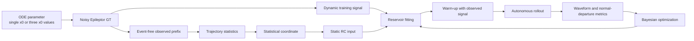

# Final SCDT code

이 폴더에는 `final_figures`의 싱글 노드 및 3-노드 GT–RC 그림을 생성하는 코드와 필수 로컬 모듈만 포함한다. Python 파일은 원본과 동일하다. 실험 결과, 캐시, 임시 분석 코드 및 사용하지 않은 대안 실험은 제외했다.

## 연구 목표

현재 실험의 목적은 정상 동역학만 관측되는 구간에서 시스템의 통계적 상태를 추정하고, 그 상태가 임계 영역으로 이동할 때 reservoir가 정상파형의 변화와 정상 이탈 확률을 함께 재현할 수 있는지 확인하는 것이다.

- **GT (ground truth)**: Epileptor ODE에서 생성한 신호
- **RC (reservoir computing)**: GT 정상 동역학을 학습한 digital twin
- **SCDT**: 관측 궤적의 통계를 정적 조건으로 사용하여 서로 다른 파라미터 상태의 동역학을 하나의 reservoir에 표현하는 구조
- **정상 이탈**: 현재 합성 실험에서는 예측 시작 5초 이후 어느 한 노드라도 신호가 `-0.5` 이하가 되는 경우
- **Survival rate**: 주어진 조건에서 예측 구간 끝까지 정상 이탈이 발생하지 않은 반복 실험의 비율

## 전체 프레임워크



Reservoir 입력은 두 종류다.

1. **Dynamic input**: 시간에 따라 변하는 궤적. 싱글 노드는 1개, 멀티 노드는 3개 신호를 사용한다.
2. **Static input**: 관측 구간에서 얻은 통계 좌표. rollout 동안 목표 파라미터 상태를 나타내는 조건으로 사용한다.

검증에서는 정상파형 오차만 보지 않는다. 정상 이탈 시점, survival-rate 곡선, 정상 구간의 평균·분산·자기상관·피크·스펙트럼과 clipping 여부를 함께 평가한다.

## 현재 싱글 노드 실험

`paper_single_node_scdt.py`가 전체 실험을 실행한다.

1. 임계 전 `x0` 값에서 긴 정상 궤적을 생성한다.
2. 여러 통계 후보 중 `x0`와 관련되고 서로 중복되지 않는 통계를 선택한다.
3. 선택된 통계와 동적 신호를 reservoir에 입력하여 정상 동역학을 학습한다.
4. 새로운 `x0`에 해당하는 통계 조건으로 autonomous rollout을 수행한다.
5. `inter`, 훈련 범위 밖의 `pre`, 임계 이후 `post`에서 GT와 RC를 비교한다.
6. BO로 reservoir 파라미터를 선택하고 survival-rate 곡선을 평가한다.

최종 그림:

- `final_figures/single_node/single_node_GT_RC_inter_pre_post.png`
- `final_figures/single_node/single_node_survival_rate.png`
- 생성 파일: `figures/RC/paper_single_node_scdt/gt_rc_inter_pre_post.png`
- 생성 rate 파일: `figures/RC/paper_single_node_scdt/survival_rate.png`

## 현재 3-노드 실험

세 노드의 `x0,1`, `x0,2`, `x0,3`를 모두 변화시킨다. 어느 한 노드만 고정하거나 변화시키는 구조가 아니다.

### 입력 구조

- Dynamic input: 세 노드의 궤적 3개
- Static input: 관측 prefix에서 계산한 9개 통계
  - node 1–3의 mean
  - node 1–3의 standard deviation
  - node 1–3의 lag-1 autocorrelation
- Reservoir nodes: 1,500
- Spectral radius 탐색 범위: 0.3–2.5
- Leakage rate 탐색 범위: 0.01–0.7

9개 통계는 미래 구간을 사용하지 않고 관측 prefix에서 계산한다. 합성 실험에서는 알려진 3차원 `x0`와 관측 통계 사이의 ridge 회귀를 적합하여 목표 통계 조건을 만든다.

### Block innovation

일반적인 한 스텝 reservoir 예측은 정상 신호의 빠른 피크와 시간적으로 이어지는 변동을 약하게 만들 수 있다. `BlockInnovationRC`는 teacher forcing에서 얻은 연속 residual 조각을 일정 길이의 block으로 샘플링하여 rollout에 더한다. 따라서 독립적인 백색 잡음보다 원래 신호의 짧은 시간 구조를 더 오래 유지할 수 있다.

### BO 및 최종 선택

1. GT의 경험적 임계 경계와 50% survival 지점 `x50`을 보정한다.
2. 1,500-node block reservoir를 100회 BO한다.
3. 정상피크 재현 항을 강화하여 100회 continuation BO한다.
4. 독립 confirmation cohort에서 후보를 다시 평가한다.
5. survival curve를 유지하면서 정상피크 오차가 개선된 모델을 최종 선택한다.

현재 합성 파이프라인은 정상 이탈 동역학을 학습시키기 위해 일부 `event_signals`도 readout 학습과 residual 계산에 사용한다. 실제 EEG 예측 실험에서는 이 부분을 그대로 사용하면 발작 정보 누출이 생길 수 있으므로, 아래 전환 계획에서는 **ictal 구간을 학습에서 제외**해야 한다.

최종 그림:

- `final_figures/multi_node/three_node_GT_RC_normal_departure.png`
- `final_figures/multi_node/three_node_survival_rate.png`
- `final_figures/multi_node/three_node_survival_rate_BO_comparison.png`
- 생성 파일: `figures/RC/three_node_scdt_block_peak_robust/gt_rc_2x2.png`
- 생성 rate 파일: `figures/RC/three_node_scdt_block_peak_robust/survival_vs_boundary.png`
- 생성 BO 비교 파일: `figures/RC/three_node_scdt_block_peak_robust/survival_rate_comparison.png`

## 코드 구조

### 직접 실행하는 파일

| 파일 | 역할 |
|---|---|
| `paper_single_node_scdt.py` | 싱글 노드 데이터 생성, 통계 선택, BO, RC 학습·테스트 및 최종 그림 생성 |
| `experiment_three_node_scdt_empirical_boundary_bo.py` | 3-노드 GT 임계 경계 보정 및 초기 BO |
| `experiment_three_node_scdt_block_bo100.py` | block innovation reservoir의 100회 BO |
| `experiment_three_node_scdt_block_peak_bo100.py` | 정상피크 항을 강화한 추가 100회 BO |
| `experiment_three_node_scdt_block_peak_confirm.py` | 독립 cohort 확인, 최종 모델 선택 및 GT–RC 그림 생성 |

### 필수 지원 모듈

| 파일 | 역할 |
|---|---|
| `paper_epileptor_core.py` | 싱글 Epileptor ODE, stochastic integration 및 event 검출 |
| `paper_single_node_feature_discovery.py` | 싱글 노드 통계 후보 계산과 선택 |
| `paper_single_node_scrc.py` | 정적 조건부 sparse reservoir, 정규화 및 BO 공통 함수 |
| `paper_network_epileptor_gt.py` | 네트워크 Epileptor GT와 결합 구조 |
| `paper_multinode_coupled_scdt.py` | 다중 출력 정적 조건부 reservoir |
| `experiment_three_node_bifurcation_rc.py` | 3차원 `x0` 표본 생성과 coupled GT 시뮬레이션 |
| `experiment_three_node_parameter_space_rc.py` | 9개 통계 계산과 통계 좌표 구성 |
| `experiment_three_node_scdt.py` | 3-노드 학습, rollout, 평가 및 plotting 공통 함수 |
| `experiment_three_node_scdt_dynamics_bo.py` | 파형과 정상 이탈을 결합한 BO 목적함수 |
| `experiment_three_node_scdt_dynamics_pilot.py` | 파형·스펙트럼 지표와 weighted readout 보조 함수 |
| `experiment_three_node_scdt_block_innovation.py` | residual block 생성 및 `BlockInnovationRC` 구현 |

지원 모듈은 별도로 실행할 필요가 없다.

## 실행 방법

아래 명령은 `final_code`를 작업 디렉터리로 사용한다.

필요 패키지:

```bash
python -m pip install -r requirements.txt
```

### Single node

```bash
python CODE/paper_single_node_scdt.py --out-dir .
```

### Multi node

```bash
python CODE/experiment_three_node_scdt_empirical_boundary_bo.py
python CODE/experiment_three_node_scdt_block_bo100.py
python CODE/experiment_three_node_scdt_block_peak_bo100.py
python CODE/experiment_three_node_scdt_block_peak_confirm.py
```

멀티 노드 단계는 앞 단계의 `experiments` 결과를 다음 단계가 읽으므로 반드시 위 순서로 실행한다.

## 실제 EEG로 전환할 때 달라지는 부분

합성 실험에서는 `x0`가 알려진 bifurcation parameter이고 ODE가 GT를 제공한다. 실제 EEG에는 `x0`와 완전한 동역학 GT가 없다. 따라서 다음 대응 관계로 구조를 바꿔야 한다.

| 합성 실험 | 실제 EEG |
|---|---|
| ODE의 1개 또는 3개 노드 | 선택한 EEG 채널 또는 PCA component |
| 알려진 `x0` | 관측 EEG 통계로 만든 잠재 위험 좌표 |
| `-0.5` 임계값 | 데이터셋의 전문가 seizure-onset annotation |
| ODE 반복 seed | 서로 다른 시간 구간, 발작 및 환자 |
| 파라미터별 survival rate | 통계 좌표 구간별 forecast horizon 내 비발작 비율 |

### 1. 데이터와 라벨 확인

SWEC 데이터를 받은 뒤 가장 먼저 다음을 표로 고정해야 한다.

- 환자별 채널 수, 채널명, sampling rate, reference 방식
- seizure onset/offset annotation과 시간 단위
- interictal, preictal, ictal 구간을 확보할 수 있는 녹화 길이
- 결측, clipping, 전극 단절 및 큰 artifact 구간
- 동일 발작 주변 window가 train과 test에 동시에 들어가지 않는 분할 기준
- EZ/PZ/BG 또는 전극 위치 정보의 실제 제공 여부와 정의

채널 수가 3개일 필요는 없다. 채널을 임의로 3개 고르기 전에 임상적 위치, 신호 품질 및 환자 간 공통성을 확인한다.

### 2. 구간과 예측 문제 정의

발작 시작 시각을 `t_onset`이라 할 때 다음 구간을 명시적으로 정한다.

- **Interictal**: 발작에서 충분히 멀리 떨어진 정상 구간
- **Preictal observation**: 발작 전 통계를 계산하고 reservoir를 warm-up하는 구간
- **Forecast horizon**: observation 종료 뒤 발작 발생 여부를 평가하는 미래 구간
- **Ictal**: `t_onset` 이후 구간. 최종 예측 실험의 학습 입력에서는 제외

환자마다 발작 수와 녹화 길이가 다르므로 window 수가 많은 환자가 결과를 지배하지 않도록 환자 단위 가중치나 균형 표본을 사용한다.

### 3. 전처리

- 원 reference를 보존한 사본과 분석용 reference를 구분한다.
- notch, band-pass, resampling, artifact rejection 기준을 train 전에 고정한다.
- scaler는 train 구간에서만 적합한다.
- onset 이후 샘플이나 test 환자의 통계가 normalization, PCA 또는 feature selection에 들어가지 않게 한다.
- 약물, 수면 단계, 장시간 baseline drift를 가능한 범위에서 기록하거나 공변량으로 관리한다.

### 4. PCA 사용과 검증

PCA는 많은 EEG 채널을 RC가 처리할 수 있는 저차원 연속 궤적으로 바꾸는 후보 방법이다. 처음에는 5개 component를 검토하되 고정된 정답으로 취급하지 않는다.

- PCA는 train 환자의 허용된 비발작 구간에만 적합한다.
- 동일한 PCA loading을 validation/test에 적용한다.
- explained variance만으로 component 수를 정하지 않는다.
- 3개와 5개 component를 포함한 여러 차원을 비교한다.
- 원신호 재구성 오차, power spectrum, 주요 피크, 채널 간 동기화 및 발작 전 CSD 통계 보존 여부를 확인한다.
- PCA 전후에 발작 전 통계 변화의 방향과 effect size가 유지되는지 검증한다.

환자별 전극 배치 차이가 크면 patient-specific PCA가 현실적일 수 있다. 환자 간 모델을 목표로 한다면 공통 채널 공간, anatomical grouping 또는 다른 spatial representation이 추가로 필요하다.

### 5. Reservoir에 넣을 통계와 CSD 검증

멀티 ODE의 `mean/std/ac1 × 3노드`를 실제 EEG에 그대로 강제하지 않는다. sliding observation window에서 다음 후보를 비교한다.

- variance 또는 log-variance
- lag-1 autocorrelation과 추정 recovery rate
- 저주파 power 증가 또는 spectral reddening
- line length, envelope, peak-to-peak amplitude
- spectral entropy 및 band-power ratio
- PCA component 또는 채널 간 correlation/synchrony

각 통계는 환자별 interictal과 preictal 분포, 시간에 따른 onset 접근 방향, effect size, 반복 발작 간 일관성을 확인한다. window length와 stride를 바꾸어 결과가 유지되는지도 검사한다. 통계 선택과 방향 결정은 train set에서만 수행한다.

실제 EEG의 survival-rate x축은 `x0` 대신 선택된 통계 하나 또는 표준화된 통계들의 저차원 위험 좌표를 사용한다. 위험 좌표는 값이 증가할수록 onset에 가까워지도록 방향을 고정하고, 좌표 구간별 표본 수와 confidence interval을 함께 표시한다.

### 6. 실제 EEG용 RC 입력안

초기 구현은 다음 구성이 적절하다.

- Dynamic input: train-only PCA로 만든 3개 또는 5개 연속 component
- Static input: 같은 observation window에서 계산한 CSD 후보 통계
- Warm-up: 해당 window의 실제 EEG/PCA 궤적
- Rollout: static condition을 유지한 autonomous RC 예측
- Output: forecast horizon 내 정상 유지 또는 통계적 정상 이탈

실제 ictal 파형을 학습하지 않는 설정에서는 RC가 발작 모양 자체를 재현한다고 주장하기보다, 정상 attractor를 유지하지 못하는지와 그 확률이 onset 위험과 관련되는지를 우선 평가한다.

### 7. 데이터 누출 방지와 검증 단위

- 한 seizure 주변의 겹치는 window는 모두 같은 split에 둔다.
- 최종 평가는 가능한 경우 leave-one-seizure-out 또는 leave-one-patient-out으로 수행한다.
- PCA, scaler, 통계 선택, 위험 좌표와 BO를 각 training fold 내부에서 다시 적합한다.
- test set은 모델 및 threshold가 완전히 고정된 뒤 한 번만 사용한다.
- window 단위 성능과 함께 seizure 단위 sensitivity, false alarms/hour, warning time을 보고한다.
- survival curve에는 환자/발작 단위 bootstrap confidence interval을 표시한다.

## 실제 EEG 전환 권장 순서

1. SWEC 메타데이터와 onset annotation을 파싱한다.
2. 환자별 원신호, 채널 및 발작 전후 구간을 시각적으로 점검한다.
3. train-only PCA 3/5차원과 원신호 보존 정도를 비교한다.
4. sliding window 통계를 계산하고 interictal–preictal 변화 및 CSD 경향을 검증한다.
5. 재현성 있는 통계만 static input과 survival-rate x축 후보로 선택한다.
6. ictal 구간을 제외한 데이터로 RC를 학습한다.
7. 먼저 관측 신호의 정상파형 재현을 확인하고, 이후 정상 이탈 및 seizure forecasting을 평가한다.
8. 독립 발작과 독립 환자에서 결과를 확인한 뒤 임상적 해석을 진행한다.

## 해석 시 주의점

- 실제 발작이 고전적인 bifurcation 또는 CSD를 따른다는 것은 검증할 가정이지 데이터 라벨 자체가 아니다.
- PCA가 높은 분산을 보존하더라도 발작 관련 정보를 보존한다는 보장은 없다.
- 통계 변화가 onset과 상관되어도 약물, 수면, artifact 또는 비정상 baseline이 원인일 수 있다.
- 합성 실험의 `-0.5` 기준과 `x0` 임계값은 실제 EEG에 직접 적용하지 않는다.
- 환자별 결과와 반복 발작 간 일관성을 함께 제시해야 전체 window를 합친 성능의 과대평가를 막을 수 있다.
